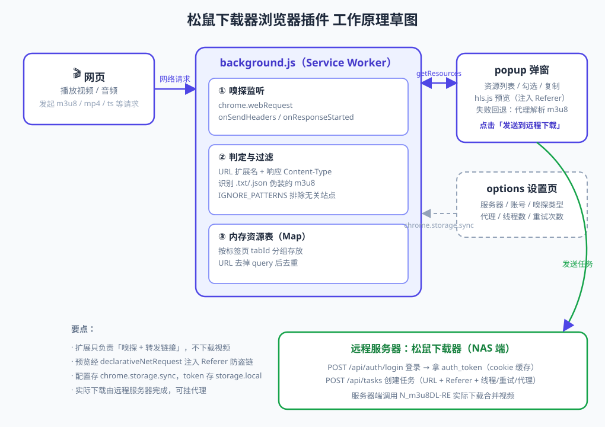
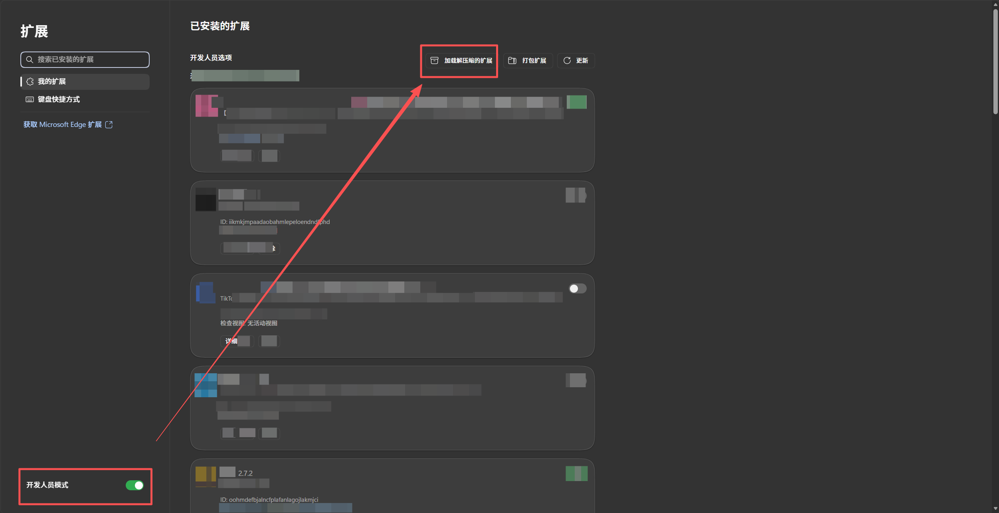
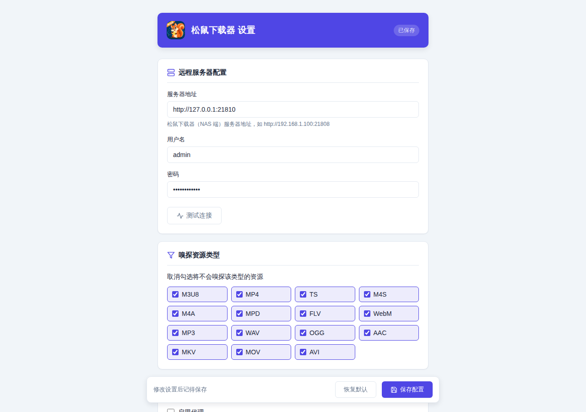
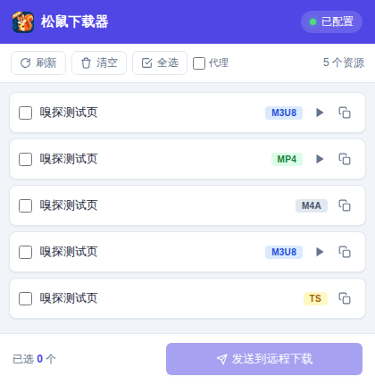

# 松鼠下载器 · 浏览器插件

浏览器视频嗅探插件（Chrome / Manifest V3），自动识别网页中的 m3u8、MP4、MPD 等媒体资源，
一键发送到 **松鼠下载器（NAS 端）** 完成下载。

> 插件本身只负责「嗅探 + 转发链接」，不下载视频；实际下载由你自己的 NAS 完成，
> 全程不经过任何第三方服务器。

## 功能特性

- 🔍 **资源嗅探** — 自动识别网页中的 m3u8、mp4、mpd 等媒体资源
- ▶️ **在线预览** — m3u8 / mp4 资源可直接在弹窗内预览播放
- 📥 **一键下载** — 勾选后发送到 NAS 端，自动合流为 MP4
- 🌐 **代理支持** — HTTP / HTTPS / SOCKS5 代理，支持快捷开关
- 🌍 **AI 翻译** — 用 AI 把视频标题翻译成中文
- 🎨 **深色模式** — 自动跟随系统切换

## 工作原理



插件通过 `chrome.webRequest` 监听页面的媒体请求，把嗅探结果列在弹窗里；
你勾选后，插件带着登录凭证调用 NAS 端服务器的 API 创建下载任务。

## 快速开始

### 1. 部署 NAS 端

插件需要一个「松鼠下载器」服务端才能工作，两种方式：

- **绿联 NAS 用户**：在 **应用中心** 搜索「松鼠下载器」安装即可（推荐，装完即用）
- **其他 Docker 环境**：参见 [松鼠下载器仓库](https://github.com/panoptes88/squirrel-downloader) 的部署说明

服务端默认监听 **21808** 端口。

### 2. 安装插件

**方式一：加载已解压的扩展程序（开发/自用）**

1. 下载本仓库代码（`git clone` 或下载 ZIP 解压）
2. 打开 `chrome://extensions/`，开启右上角「开发者模式」
3. 点击「加载已解压的扩展程序」，选择本仓库目录



**方式二：从 Chrome 应用商店安装**

> 上架审核中，通过后此处会补充商店链接。

### 3. 配置插件

右键扩展图标 → **选项** → 填写服务器地址、用户名、密码 → **测试连接** → 保存。

```
服务器地址：http://192.168.1.100:21808
用户名：admin
密码：你在安装 NAS 端时设置的密码
```



> 如果浏览器提示跨域（CORS）失败，需要在 NAS 端设置允许插件来源。
> 详见 [高级配置](wiki/高级配置.md)。

## 基本使用

1. 打开包含视频的网页
2. 播放视频（触发资源嗅探）
3. 点击扩展图标查看嗅探到的资源
4. 勾选要下载的资源
5. 点击「发送到远程下载」



## 详细文档

📖 完整文档请查看 [Wiki](wiki/)

- [部署教程](wiki/部署教程.md)
- [插件安装](wiki/插件安装.md)
- [使用教程](wiki/使用教程.md)
- [高级配置](wiki/高级配置.md)
- [常见问题](wiki/常见问题.md)

## 开发

本项目**没有构建系统**：纯原生 HTML / CSS / JavaScript，无 npm、无打包步骤。
改完代码在 `chrome://extensions/` 点扩展卡片上的刷新按钮即可生效。

调试：

- **后台逻辑**：在 `chrome://extensions/` 点扩展的「Service Worker」查看日志，
  日志统一带 `[松鼠下载器]` 前缀
- **弹窗 / 设置页**：在页面内右键 → 检查，直接打开 DevTools

项目结构、代码风格与安全约定见 [AGENTS.md](AGENTS.md)。

重新生成图标（改了 `icons/icon-source.png` 之后）：

```bash
python3 scripts/make-icons.py
```

## 相关项目

- [松鼠下载器](https://github.com/panoptes88/squirrel-downloader) — 配套的 NAS 端下载服务器
- [N_m3u8DL-RE](https://github.com/nilaoda/N_m3u8DL-RE) — 服务端实际使用的下载引擎
- [cat-catch](https://github.com/xifangczy/cat-catch) — 嗅探实现的设计参考

## 许可证

本项目以 [MIT](LICENSE) 许可发布。

随包分发的第三方组件（hls.js）遵循其自身许可，见
[THIRD_PARTY_LICENSES.md](THIRD_PARTY_LICENSES.md)。
